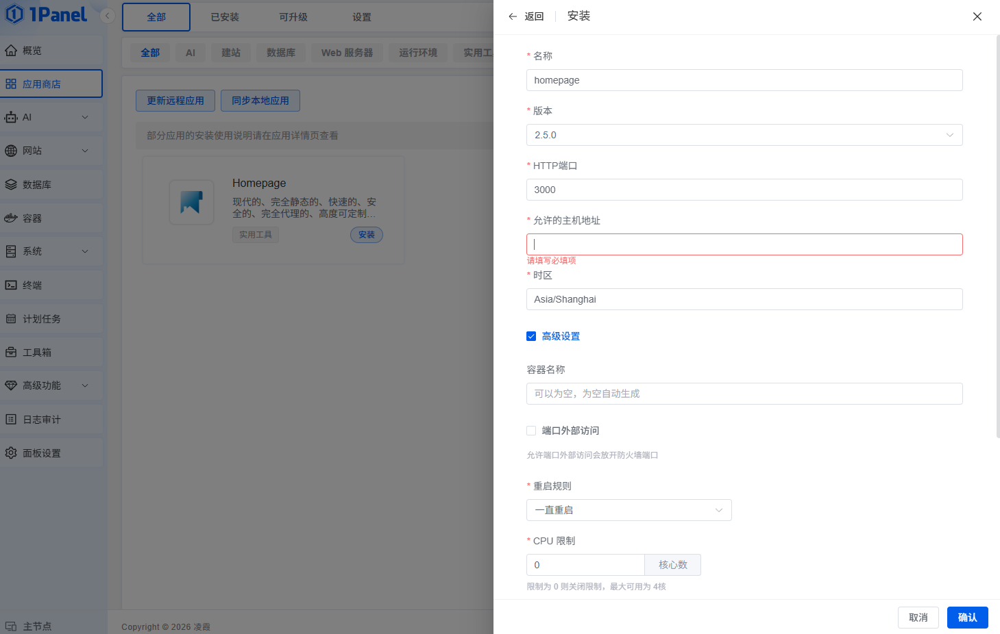

# 1pannel 使用
> [github仓库](https://github.com/1Panel-dev/1Panel)

## 安装
1. 命令行执行
    ```sh
    sudo bash -c "$(curl -sSL https://resource.1panel.pro/v2/quick_start.sh)"
    ```

    国内速度太慢可以替换以下命令安装
    ``` sh
    sudo bash -c "$(curl -sSL https://resource.fit2cloud.com/1panel/package/v2/quick_start.sh)"
    ```
2. 选择对应语言, 安装目录，docker检查，设置端口号，用户名密码

### 安装homepage
* 应用商店搜索homepage，安装
    * 允许的主机地址：`<本机IP>:<端口号>`
    * 勾选端口外部访问
        
    启动后进入`容器`，选择homgpage容器->`更多`->`编辑`，修改服务器端口与允许的端口一致，确定重建启动后可访问

### 安装