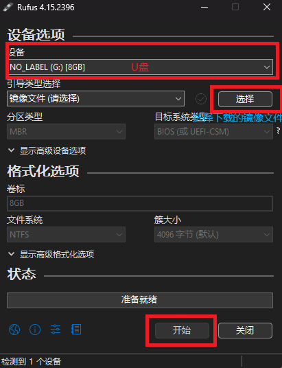

1. 从官网下载ubuntu镜像（以下载24.04.4 LTS为例）
    - 登录https://ubuntu.net.cn/download/server
    - 根据需要下载最新版或其他下载方式中的先前版本

2. 制作Ubuntu Server启动盘
    - windows 下载Rufus后打开
    - 选择u盘和下载好的ISO文件，点击“开始”等待写入完成即可。
    - 
3. 进入BIOS：将U盘插入工控机，开机时连续敲击 F2、F12、Del 或 Esc 键（不同主板按键不同），进入BIOS设置界面
4. 在`boot`或`security`菜单中找到 `Secure Boot`设置为`disable`,部分品牌没有这个选项，则跳过
5. `boot`中设置模式为`UEFI `而不是`Legacy`
6. `boot option`或`Boot Priority` 或 `Boot Order`设置U盘（UEFI）为第一启动项
7. 保存退出bios，重启后自动进入GRUB菜单，选择 "Try or Install Ubuntu Server" 即可进入安装程序。
8. 依次选择语言，键盘布局，系统类型，网卡设置 磁盘设置，安装ssh等
9. 等待安装完成，重启拔掉U盘，进入系统
10. 更换国内软件源 (APT)
    ```sh
    # 1. 备份原配置文件
    sudo cp /etc/apt/sources.list.d/ubuntu.sources /etc/apt/sources.list.d/ubuntu.sources.bak

    # 2. 编辑源文件
    sudo nano /etc/apt/sources.list.d/ubuntu.sources
    ```
    替换下列内容后保存退出
    ```txt
    Types: deb
    URIs: https://mirrors.aliyun.com/ubuntu/
    Suites: noble noble-updates noble-backports
    Components: main restricted universe multiverse
    Signed-By: /usr/share/keyrings/ubuntu-archive-keyring.gpg

    Types: deb
    URIs: https://mirrors.aliyun.com/ubuntu/
    Suites: noble-security
    Components: main restricted universe multiverse
    Signed-By: /usr/share/keyrings/ubuntu-archive-keyring.gpg
    ```
11. 执行更新
    ```sh
    sudo apt update && sudo apt upgrade -y
    ```
12. 安装docker,参考[官网教程](https://docs.docker.com/engine/install/ubuntu/)
    ```sh
    # 更新索引并安装依赖
    sudo apt update
    sudo apt install -y ca-certificates curl

    # 添加 Docker 的 GPG 密钥（使用中科大镜像）
    sudo install -m 0755 -d /etc/apt/keyrings
    sudo curl -fsSL https://mirrors.ustc.edu.cn/docker-ce/linux/ubuntu/gpg -o /etc/apt/keyrings/docker.asc
    sudo chmod a+r /etc/apt/keyrings/docker.asc

    # 添加 Docker 软件源（使用中科大镜像）
    echo \
    "deb [arch=$(dpkg --print-architecture) signed-by=/etc/apt/keyrings/docker.asc] https://mirrors.ustc.edu.cn/docker-ce/linux/ubuntu/ \
    $(. /etc/os-release && echo "$VERSION_CODENAME") stable" | \
    sudo tee /etc/apt/sources.list.d/docker.list > /dev/null

    # 安装 Docker
    sudo apt update
    sudo apt install -y docker-ce docker-ce-cli containerd.io docker-buildx-plugin docker-compose-plugin

    # 安装后，将你的用户加入 docker 组，以后运行 docker 命令就不需要每次都加 sudo 了
    sudo usermod -aG docker $USER
    ```
    配置docker镜像加速
    ```sh
    sudo mkdir -p /etc/docker
    sudo tee /etc/docker/daemon.json <<-'EOF'
    {
    "registry-mirrors": [
        "https://docker.1ms.run",
        "https://docker.xuanyuan.me"
    ]
    }
    EOF
    ```
    重启 Docker 服务使配置生效：
    ```sh
    sudo systemctl daemon-reload
    sudo systemctl restart docker
    ```
13. 使用`date`命令查看当前时间，若时间时区对不上，修改时区
    ```sh
    sudo timedatectl set-timezone Asia/Shanghai
    ```
    配置国内 NTP 服务器
    ```sh
    sudo nano /etc/systemd/timesyncd.conf
    ```
    ```txt
    将#NTP=行替换为
    NTP=ntp.aliyun.com ntp.tencent.com
    ```
    ```sh
    # 保存后保存后重启服务并验证状态
    sudo systemctl restart systemd-timesyncd
    timedatectl status
    # 看到 System clock synchronized: yes 和 NTP service: active 时，说明时间同步已正常工作。
    ```


    